# Bowling Tótem: cómo funciona y cómo lo construimos

*Escuela Industrial Nº4 “José Menéndez” · 5ºI Informática · 2026*

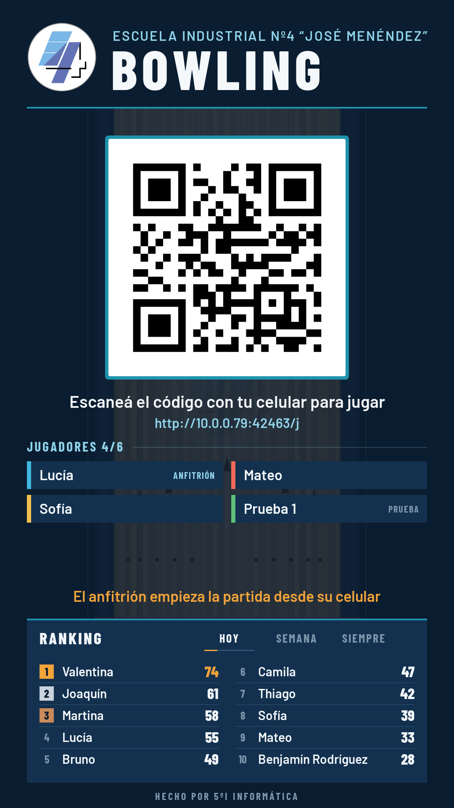

## 1. Qué es

Bowling Tótem es un juego de bolos en 2D (visto desde arriba) para una pantalla vertical grande de 1080 × 1920 píxeles, tipo tótem, que se puede poner en un pasillo o en una muestra de la escuela. No hace falta un joystick ni un teclado: **cada jugador usa su propio celular como control**. Escanea el código QR que aparece en el tótem, escribe su nombre y tira la bola deslizando el dedo hacia arriba en la pantalla del celular.

Pueden jugar de 1 a 6 personas por partida. Los puntajes se guardan en un ranking (de hoy, de la semana y de siempre) que se ve en el tótem y en una página web aparte. Todo funciona en la red local de la escuela, **sin internet**.

## 2. Cómo se juega

1. **Lobby:** el tótem muestra el QR, la lista de jugadores que se van sumando y el ranking, que va rotando entre tablas. Si no hay nadie, una demo tira bolas sola de fondo.
2. **Entrar:** cada jugador escanea el QR y escribe un nombre de 2 a 14 letras. El primero que entra es el **anfitrión** y tiene el botón «Empezar».
3. **Cuenta regresiva** de 3 segundos.
4. **Turnos:** cada jugador juega su frame completo: 1 o 2 tiros, y hasta 3 en el último frame si hace pleno o semipleno. En su turno el celular vibra y muestra una mini pista con los pinos que siguen en pie:
   - **arrastrar la bola a los costados** elige desde dónde sale; el tótem la mueve en vivo;
   - **deslizar hacia arriba** tira. La velocidad del dedo da la fuerza, el ángulo del trazo da la dirección y la curva del trazo le da efecto a la bola.
5. **Resultados:** podio con los puntajes, el puesto de cada uno en el ranking del día y un festejo si alguien bate el récord de la escuela.
6. Los que entran con la partida empezada quedan como **espectadores** y pueden mandar reacciones (👏 🔥 😂 😱 🎳), que aparecen flotando en el tótem.

| Turno en el tótem | El celular de quien tira | Resultados |
|---|---|---|
| 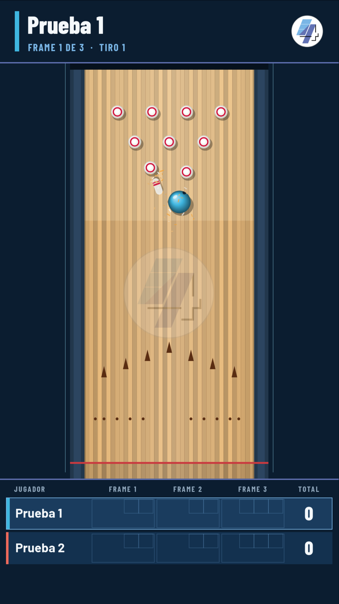 | 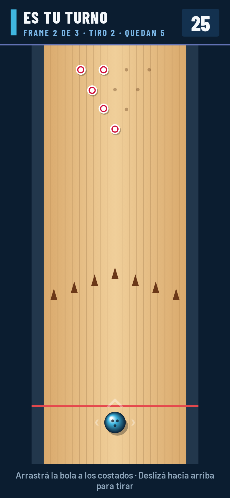 | 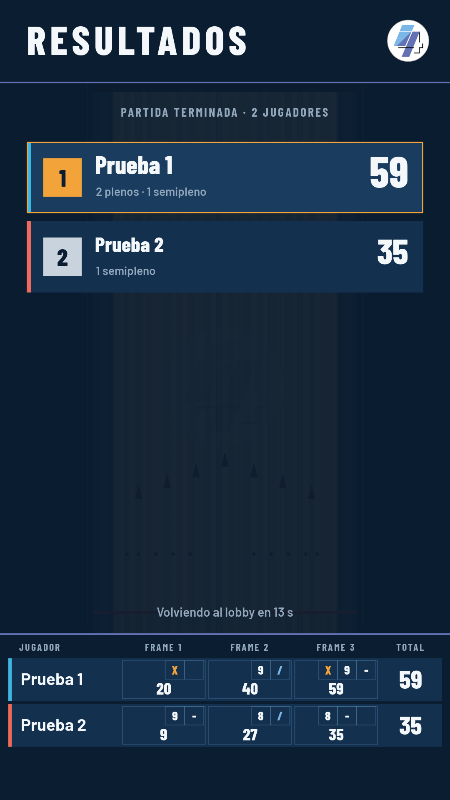 |

El puntaje es el **oficial del bowling**: el pleno (los 10 pinos en el primer tiro) suma 10 más los dos tiros siguientes, y el semipleno (los 10 entre los dos tiros) suma 10 más el tiro siguiente. Por defecto la partida es de 3 frames para que sea corta, pero se puede cambiar.

## 3. Cómo está armado

El sistema tiene **tres partes** que se comunican por la red local:

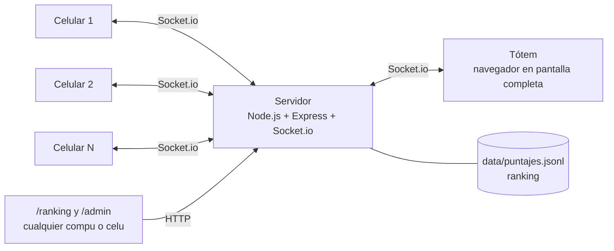

- **El servidor** (`server.js`) corre en la compu del tótem. Sirve las páginas, maneja quién está conectado (el lobby), reenvía los mensajes entre los celulares y el tótem, y guarda los puntajes. **No simula el juego.**
- **El tótem** (`public/totem/`) es una página web que se abre en Chrome en modo kiosco (pantalla completa, sin barras). Es **la autoridad del juego**: ahí corren la física, los turnos y el puntaje, y ahí se dibuja todo.
- **Los celulares** (`public/control/`) solo mandan gestos (apuntar, tirar, reaccionar) y muestran lo que les llega: de quién es el turno, su puntaje y su puesto.

Decidimos que el tótem sea la autoridad, y no el servidor, porque la física necesita correr 60 veces por segundo pegada al dibujo. Si la simulación estuviera en el servidor, habría que mandar las posiciones de la bola y de los 10 pinos por la red en cada cuadro. Así el servidor queda simple y casi no hace trabajo.

## 4. Lenguajes y tecnologías

Todo el proyecto está hecho con **tecnologías web** y un solo lenguaje de programación, **JavaScript**: en el servidor con Node.js y en los navegadores del tótem y de los celulares. No usamos frameworks de interfaz como React: las pantallas están escritas a mano con HTML, CSS y JavaScript, y el juego se dibuja en un `<canvas>`.

| Tecnología | Para qué la usamos |
|---|---|
| **JavaScript** (Node.js 24 y navegador) | Toda la lógica: servidor, juego, física, control del celular, ranking |
| **HTML5** | La estructura de las páginas (tótem, control, ranking, admin) |
| **CSS3** | El diseño de las páginas del celular, el ranking y el admin (variables de color, flexbox, grid) |
| **Canvas 2D** | El dibujo del tótem: la pista, los pinos, la bola, las animaciones, el tablero |
| **SVG** | El logo de la escuela, redibujado en vector para que se vea nítido a cualquier tamaño |
| **Express 5** | El servidor web: páginas, imágenes, el QR y la API del ranking y del admin |
| **Socket.io 4** | La comunicación en tiempo real (WebSockets) entre los celulares, el servidor y el tótem |
| **Matter.js** | El motor de física 2D: choques entre la bola y los pinos, y entre pinos |
| **qrcode** | Genera el código QR en el propio servidor (así no hace falta internet) |
| **Barlow** (Fontsource) | La tipografía, incluida en el proyecto para que ande sin conexión |
| **Web Audio API** | Los sonidos, que se generan en el momento (no hay archivos de audio) |
| **Pointer Events, Vibration, Wake Lock, localStorage** | Funciones del navegador en el celular: el gesto con el dedo, la vibración en el turno, que la pantalla no se apague y recordar el nombre |
| **JSON Lines** | El formato del archivo donde se guardan los puntajes |
| **node:test** y **Playwright** | Las pruebas automáticas: unitarias, y con navegadores reales emulando el tótem y los celulares |
| **Bash** y **Batch** | Los lanzadores con doble clic (`iniciar.sh` en Linux, `iniciar.bat` en Windows) |

En números: unas **4.600 líneas** de código del juego (servidor ≈ 900, tótem ≈ 1.850, celular ≈ 840, ranking y admin ≈ 590, código compartido ≈ 440) y unas **2.400 líneas** de pruebas.

## 5. Estructura del proyecto

```
bowling-totem/
├── server.js            servidor: páginas, lobby, mensajes, QR, API del ranking y del admin
├── leaderboard.js       guardar y consultar puntajes, filtro de nombres, copias de seguridad
├── config.json          nombre de la escuela, frames, jugadores, PIN, créditos…
├── iniciar.sh / .bat    arrancan todo con doble clic
├── data/                puntajes (se crea solo)
├── public/
│   ├── totem/           pantalla del tótem: game.js (reglas), totem.js (dibujo), sound.js
│   ├── control/         página del celular: control.js, gesture.js (el gesto del dedo)
│   ├── ranking/         ranking completo con historial de cada jugador
│   ├── admin/           panel con PIN
│   └── shared/          física, puntaje, tema de colores, logo
└── test/                pruebas automáticas
```

Separamos las **reglas del juego** (`game.js`, `scoring.js`, `physics.js`) del **dibujo** (`totem.js`). Las reglas no usan nada del navegador, así que las podemos probar en Node sin abrir ninguna pantalla: adelantamos el reloj a mano y comprobamos los turnos, los tiros automáticos o qué pasa si alguien se desconecta.

## 6. La comunicación en tiempo real

Los celulares y el tótem están conectados todo el tiempo al servidor con **WebSockets** (mediante Socket.io), una conexión que queda abierta y permite mandar mensajes en las dos direcciones al instante. Algunos de los mensajes:

| Mensaje | De → a | Qué lleva |
|---|---|---|
| `player:join` | celular → servidor | nombre y un *token* para poder reconectarse |
| `lobby:update` | servidor → todos | la lista de jugadores, quién es el anfitrión y quién está conectado |
| `player:aim` / `player:throw` | celular → tótem | posición de salida; fuerza, dirección y efecto del tiro |
| `game:state` | tótem → celulares | de quién es el turno, el puntaje, los pinos que quedan en pie |
| `game:over` | tótem → servidor | los puntajes finales, para guardarlos |
| `leaderboard:update` | servidor → todos | las tablas del ranking actualizadas |

El servidor **no confía** en lo que mandan los celulares:
- Acepta tiros solo del jugador al que le toca, como máximo uno por segundo.
- Recorta los valores a rangos válidos.
- Valida los nombres: largo, solo letras y números, y un filtro de malas palabras editable.
- Si un celular pierde la conexión y vuelve (por ejemplo, porque se bloqueó la pantalla), recupera su lugar gracias al *token* que guardó.

## 7. El tótem por dentro

### El bucle del juego
Como en cualquier videojuego, el tótem repite un ciclo unas **60 veces por segundo**: actualiza el estado (el reloj, la física, los turnos) y dibuja la pantalla. La partida pasa por fases: `lobby → cuenta regresiva → jugando → resultados → lobby`. Cada turno, a su vez, pasa por `apuntando → rodando → resultado`.

### La física
Usamos **Matter.js** con la gravedad en cero, porque la pista se ve desde arriba. La bola es más pesada que los pinos, y estos tienen rozamiento con el aire y rebote. Para ajustar los números armamos un **simulador** (`npm run sim`) que tira cientos de bolas sin dibujar nada y mide el porcentaje de plenos, de canaletas y cuánto dura cada jugada.

El descubrimiento más importante fue que **en 2D los pinos no se caen sobre sus vecinos** como en la realidad, así que casi no salían plenos. Lo resolvimos dándole al pino un **radio de choque más grande que el que se dibuja**: se dibuja de 21 píxeles pero choca como si midiera 26,5. Con eso, los tiros "al bolsillo", entre el pino 1 y el 3 con efecto, dan pleno alrededor del 40 % de las veces, parecido a un jugador real.

Otros detalles:
- El efecto curva la bola solo en el último tramo de la pista.
- La canaleta se detecta antes de que la bola llegue a los pinos.
- Hay **cámara lenta** cuando la bola llega a los pinos.
- Para el segundo tiro se sacan los pinos caídos y los demás quedan donde quedaron.

### El dibujo y el rendimiento
Todo se dibuja a mano en **Canvas 2D**: la pista de madera con sus tablas y flechas, las sombras, la bola que gira, las chispas al chocar y el confeti en los plenos.

Al principio el tótem andaba lento en algunas compus. Medimos con un perfilador y encontramos la causa: **redibujábamos 60 veces por segundo cosas que casi nunca cambian** (el tablero de puntajes, el encabezado y la pista). Lo resolvimos así:
- Usamos **dos lienzos superpuestos**: uno de fondo, que se dibuja una sola vez, y otro que se redibuja en cada cuadro solo con lo que se mueve.
- Guardamos el tablero y el encabezado como imágenes en memoria (*caché*), que se rehacen solo cuando cambia un puntaje o el reloj.
- Sacamos los efectos de brillo (`shadowBlur`), que son muy caros.

Con esos cambios, simulando una compu tres veces más lenta y sin placa de video, el juego pasó de **28 a 59 cuadros por segundo**.

### El sonido
No hay archivos de audio: con la **Web Audio API** generamos los sonidos en el momento, a partir de ruido y osciladores. Hay un ruido grave cuando rueda la bola (más fuerte cuanto más rápida va), un "clac" en cada choque según su fuerza, una fanfarria en el pleno y pitidos en la cuenta regresiva.

## 8. El celular por dentro

La pantalla de tiro dibuja una mini pista en un canvas, con los mismos pinos que siguen en pie en el tótem. Mientras el dedo se mueve guardamos sus puntos. Al soltar, `gesture.js` los convierte en un tiro:

- **fuerza** = velocidad del último tramo del deslizamiento;
- **dirección** = ángulo entre el punto de inicio y el final;
- **efecto** = cuánto se separa el trazo de una línea recta (si la "panza" va a la izquierda, la bola engancha a la derecha).

El celular espera la **confirmación** del servidor. Si el tiro se pierde por el wifi, deja tirar de nuevo en lugar de quedar trabado. Además pide que la pantalla no se apague durante la partida y recuerda el nombre para la próxima vez.

| Entrar | Esperar en el lobby | Mirar el turno de otro | Resultado y puesto |
|---|---|---|---|
| 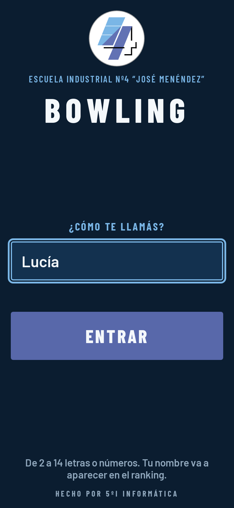 | 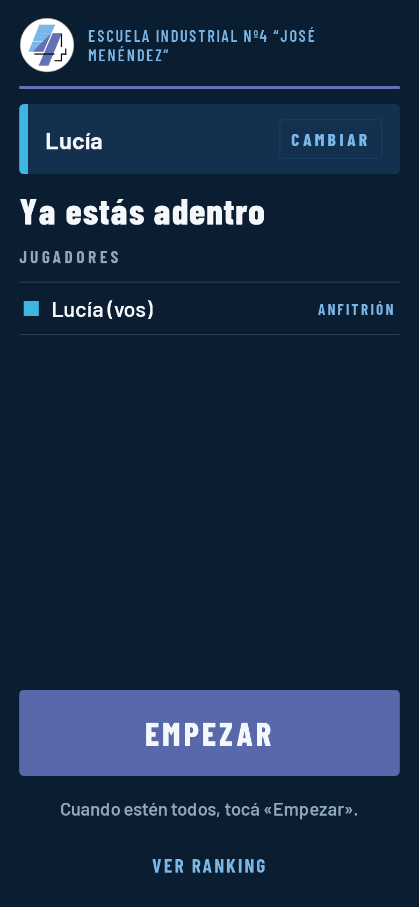 | 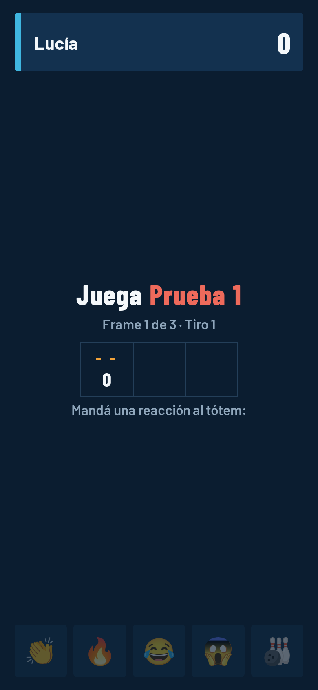 | 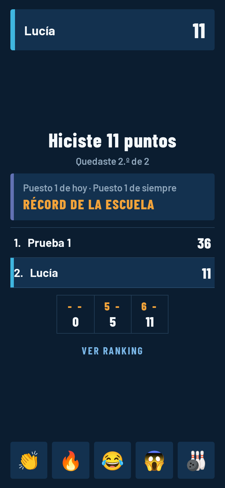 |

## 9. El ranking y los datos

Cada puntaje se guarda como **una línea de texto en formato JSON** dentro de `data/puntajes.jsonl`, con el nombre, el puntaje, los plenos, la fecha y la partida. Elegimos este formato (JSON Lines) porque guardar es solo **agregar una línea al final** del archivo: nunca se reescribe, así que si se corta la luz no se pierde lo anterior. Al leerlo, una línea dañada se ignora sin romper el resto.

- **Tablas:** hoy (con la hora de Argentina), la semana y siempre, más "mejores jugadores", que es el mejor puntaje de cada persona con su promedio. "Lucía", "lucia" y "LUCÍA" cuentan como la misma persona.
- **Desempate:** gana quien hizo más plenos y, si siguen empatados, quien lo logró antes.
- **Borrar** un puntaje no lo elimina del archivo: se agrega una línea que lo marca como borrado.
- **Copia de seguridad** automática una vez por día.
- **`/ranking`:** página para el celular o la compu, con pestañas, buscador y el historial de partidas de cada jugador.
- **`/admin`:** protegido con un PIN, permite borrar puntajes, exportar todo a Excel (CSV) y reiniciar el ranking para un torneo.

| Ranking en el celular | Historial de un jugador | Panel de administración |
|---|---|---|
| 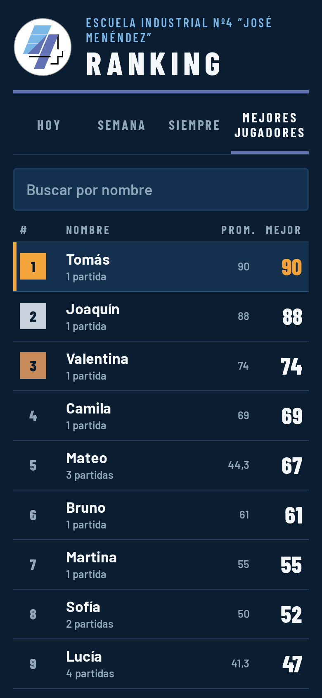 | 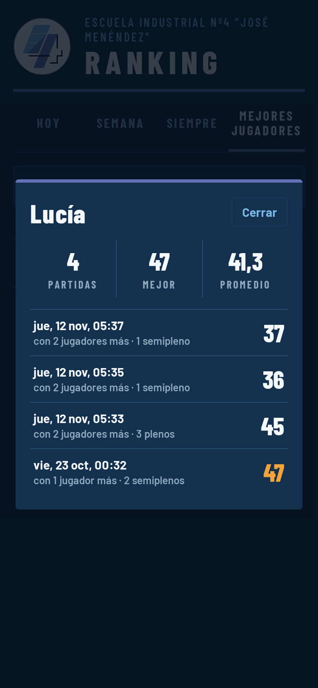 | 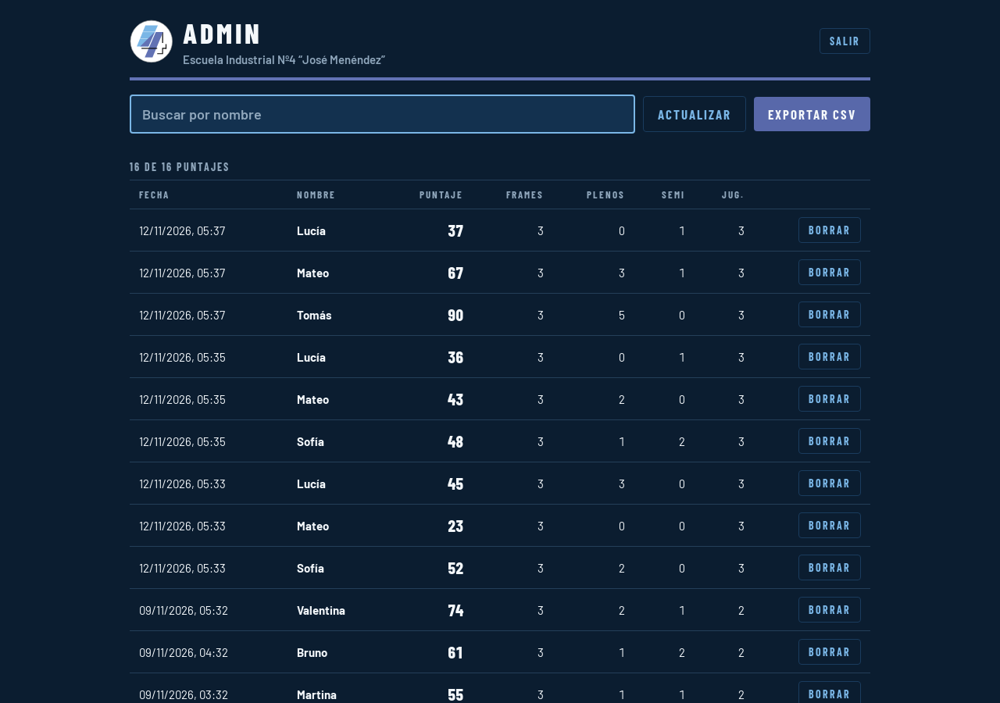 |

## 10. El diseño visual

Buscamos que el juego se vea como de la escuela y no como una plantilla genérica. Lo llamamos estilo **“Institucional Nº4”**:

- **Logo:** el de la escuela, que redibujamos en vector (SVG) calcándolo del sitio oficial. Aparece en el lobby, en el encabezado de la partida, como marca de agua en la pista y en todas las páginas.
- **Colores:** salen del logo. Azul noche de fondo, el **azul** (`#6272B4`) y el **celeste** (`#7AB6E6`) del logo como acentos, y **naranja** (`#F2A33A`) solo para lo importante: plenos, récords y los últimos segundos del reloj. Revisamos el contraste de los textos con la fórmula de las pautas de accesibilidad WCAG.
- **Tipografía:** Barlow y Barlow Condensed, que tienen un aire técnico, de escuela industrial.
- **Formas:** planas, sin brillos ni degradados, con pocos signos de exclamación.

## 11. Pruebas y calidad

Hicimos pruebas automáticas para no tener que probar todo a mano cada vez que cambiábamos algo:

- **79 pruebas unitarias** (`npm test`) del puntaje, la física, el gesto del dedo, las reglas del juego, el servidor y el ranking.
- **Pruebas de punta a punta con Playwright**, que abre navegadores de verdad. La más completa (`npm run prueba:final`) hace esto:
  1. arma un tótem con 3 celulares emulados que juegan una partida entera deslizando el dedo;
  2. un jugador se desconecta y vuelve;
  3. una espectadora manda reacciones;
  4. reinicia el servidor y verifica que los puntajes sigan ahí;
  5. comprueba que ninguna página tenga errores en la consola.
- **Prueba de rendimiento** (`npm run prueba:rendimiento`): mide los cuadros por segundo simulando una compu lenta.

También hicimos una **auditoría** del código buscando todo lo que pudiera romper el juego. Algunos de los problemas que encontramos y arreglamos:
- un mensaje mal armado desde un celular podía apagar el servidor;
- un solo error en un cuadro congelaba el tótem para siempre;
- un celular que se bloqueaba en los resultados quedaba trabado en esa pantalla;
- los puntajes podían perderse si se cortaba la conexión justo al terminar.

Para cada uno escribimos primero una prueba que lo mostraba y después el arreglo.

## 12. Cómo se pone en marcha

1. Instalar **Node.js** en la compu del tótem y, la primera vez, ejecutar `npm install` (es lo único que necesita internet).
2. Hacer doble clic en `iniciar.bat` (Windows) o `iniciar.sh` (Linux): se levanta el servidor y se abre el tótem en pantalla completa.
3. Los celulares tienen que estar **en la misma red wifi** y escanear el QR.

Los detalles de instalación, la configuración y la solución de problemas (firewall, redes que aíslan a los dispositivos, etc.) están en el `README.md`.

---

**Hecho por 5ºI Informática** · Escuela Industrial Nº4 “José Menéndez” · Río Gallegos, Santa Cruz
