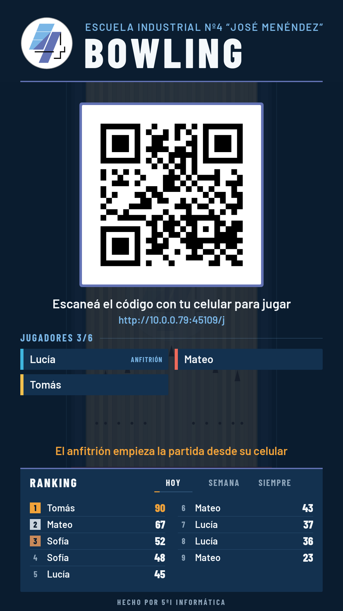

# Bowling Tótem

Juego de bowling 2D para un tótem vertical (1080 x 1920). Cada jugador usa **su celular como control**: escanea el QR del tótem, pone su nombre y tira deslizando el dedo. De 1 a 6 jugadores por partida, con ranking que se guarda para siempre. Funciona en **red local, sin internet**.



## Requisitos

- Una compu para el tótem (Windows o Linux) con **Node.js 20 o superior** ([nodejs.org](https://nodejs.org), versión LTS).
- **Chrome, Chromium o Edge** para abrir la pantalla del tótem.
- Un **router o punto de acceso wifi** al que se conecten el tótem y los celulares (ver [Si los celulares no se conectan](#si-los-celulares-no-se-conectan)).
- Para ver los emojis de las reacciones en Linux: la fuente *Noto Color Emoji*.

## Instalación

1. Copiar la carpeta `bowling-totem` a la compu del tótem.
2. Abrir una terminal en esa carpeta y correr, **una sola vez y con internet**:

   ```
   npm install --omit=dev
   ```

   (Los scripts `iniciar.bat` / `iniciar.sh` lo hacen solos si falta la carpeta `node_modules`.)

## Cómo arrancar

**Lo más fácil: doble clic en `iniciar.bat` (Windows) o `iniciar.sh` (Linux).** Levanta el servidor, espera a que responda y abre el navegador en modo kiosco (pantalla completa, sin barras) con sonido habilitado.

- Para salir del kiosco: **Alt+F4**.
- Windows: el servidor queda en una ventana minimizada llamada *Bowling Totem - servidor*; cerrarla apaga el juego.
- Linux: al cerrar el navegador también se apaga el servidor. Si el doble clic abre el archivo como texto, darle permiso de ejecución (`chmod +x iniciar.sh`) o elegir "Ejecutar" en el explorador de archivos.

**A mano**, en dos pasos:

```
npm start
```

La consola muestra las direcciones:

```
  🎳 Bowling Tótem — Industrial Nº4 José Menéndez
  Tótem (abrir en esta compu):  http://localhost:3000
  Celulares (QR):               http://192.168.0.5:3000/j
  Ranking:                      http://localhost:3000/ranking
  Admin (PIN de config.json):   http://localhost:3000/admin
```

Después abrir el tótem en modo kiosco:

- **Linux:** `chromium --kiosk --autoplay-policy=no-user-gesture-required http://localhost:3000`
- **Windows:** `"C:\Program Files\Google\Chrome\Application\chrome.exe" --kiosk --autoplay-policy=no-user-gesture-required http://localhost:3000`
  (con Edge: `msedge.exe` en `C:\Program Files (x86)\Microsoft\Edge\Application\`).

Para que arranque solo al prender la compu: poner un acceso directo a `iniciar.bat` en la carpeta *Inicio* de Windows (`Win+R` → `shell:startup`) o agregar `iniciar.sh` a las aplicaciones de inicio del escritorio en Linux.

## Cómo se juega

1. En el tótem aparece un QR. Cada jugador lo escanea, escribe su nombre (2 a 14 letras o números) y entra.
2. El primero que entra es el **anfitrión** y tiene el botón **¡Empezar!** (también sirve Enter en el tótem).
3. En su turno, el celular vibra y muestra la pista con los pinos que siguen en pie: **arrastrar la bola a los costados** elige desde dónde sale y **deslizar hacia arriba** la tira. Más rápido = más fuerza; un trazo curvo le da efecto.
4. Si alguien no tira en 25 segundos, sale un tiro automático suave. Si cuando le toca está desconectado hace más de 5 segundos, pierde ese frame; si vuelve, sigue jugando los siguientes.
5. Quien entra con la partida empezada queda de **espectador** para la próxima y puede mandar reacciones (👏 🔥 😂 😱 🎳) que aparecen en el tótem.
6. Al final se ve el podio, el puesto de cada uno en el ranking y, si alguien bate el récord, un festejo especial.

## Configuración (`config.json`)

```json
{
  "nombreEscuela": "Escuela Industrial Nº4 “José Menéndez”",
  "frames": 3,
  "maxJugadores": 6,
  "puerto": 3000,
  "segundosPorTurno": 25,
  "pinAdmin": "1234",
  "segundosRotacionRanking": 8,
  "creditos": "Hecho por 5ºI Informática"
}
```

| Campo | Qué hace |
|---|---|
| `nombreEscuela` | Se muestra en el lobby, en la pista (si no hay logo) y en el ranking |
| `frames` | Frames por partida. El ranking solo compara partidas con la misma cantidad |
| `maxJugadores` | Máximo por partida (los demás quedan de espectadores) |
| `puerto` | Puerto del servidor. También se puede cambiar al arrancar: `PORT=8080 npm start` |
| `segundosPorTurno` | Tiempo para tirar antes del tiro automático |
| `pinAdmin` | PIN del panel de administración. **Cambialo antes de usarlo en la escuela** |
| `segundosRotacionRanking` | Cada cuánto cambia la tabla del ranking en el lobby |
| `creditos` | Quién hizo el juego: se muestra al pie del lobby, en el celular, en `/ranking` y en `/admin` |

Después de editar `config.json` hay que reiniciar el servidor.

Si la compu tiene varias redes y el QR muestra una IP equivocada, se puede forzar: `IP_TOTEM=192.168.0.5 npm start` (en Windows: `set IP_TOTEM=192.168.0.5` y después `npm start`).

### Cambiar el logo

El juego trae el logo de la Escuela Industrial Nº4 “José Menéndez” redibujado en vector (`public/shared/emblema.svg`, calcado del logo del [sitio oficial de la escuela](https://sites.google.com/view/escuelaindustrial4/inicio)). Aparece en el lobby, en el encabezado de la partida, como marca de agua en la pista, en el celular, en `/ranking` y en `/admin`.

Para usar otro archivo (por ejemplo, una versión oficial en alta calidad), ponerlo como **`public/logo.png`** (cuadrado, con fondo transparente, 600 px o más) y recargar el tótem (F5): si existe, se usa ese en lugar del SVG.

### Diseño

Estilo “Institucional Nº4”: azul noche de fondo, el azul y el celeste del logo como acentos y naranja solo para lo destacado (plenos, récords, el reloj en los últimos segundos). Tipografías Barlow y Barlow Condensed, que vienen en las dependencias (`@fontsource`) y se sirven desde la misma compu: no hace falta internet para verlas, solo para el primer `npm install`. Los colores están en `public/shared/tema.css` (celular, ranking y admin) y en la constante `PAL` de `public/totem/totem.js` (tótem).

## Ranking

- Se ve en el lobby del tótem (rota entre **Hoy**, **Semana** y **Siempre**) y en la página **`/ranking`** (`http://IP-DEL-TOTEM:3000/ranking`), que se abre desde el botón *Ver ranking* del celular o desde cualquier compu de la red. Tiene pestañas, buscador y el historial de partidas de cada persona.
- Nombres con y sin tildes o mayúsculas cuentan como la misma persona ("Lucía" = "lucia").
- Empates: gana quien hizo más plenos y, si siguen empatados, quien lo logró antes.
- Los jugadores de prueba del tótem (tecla P) no se guardan.
- Filtro de malas palabras: lista editable en `data/palabras-prohibidas.txt` (una palabra por renglón; se aplica al instante, sin reiniciar).

## Panel de administración (`/admin`)

Abrir `http://localhost:3000/admin` y poner el PIN de `config.json`. Desde ahí se puede:

- **Buscar y borrar** un puntaje (por ejemplo, un nombre ofensivo que pasó el filtro). Se marca como borrado; el renglón original queda en el archivo.
- **Exportar CSV** para abrir en Excel o Google Sheets (con tildes bien).
- **Reiniciar el leaderboard** (por ejemplo, para un torneo): pide escribir REINICIAR, archiva todos los puntajes en `data/archivo/` y empieza de cero. No se pierde nada.

Después de 5 PIN incorrectos seguidos, el panel se bloquea un minuto para esa compu. Para **cambiar el PIN**, editar `pinAdmin` en `config.json` y reiniciar el servidor.

## Dónde se guardan los puntajes

Todo está en la carpeta **`data/`** (se crea sola):

| Archivo | Qué es |
|---|---|
| `data/puntajes.jsonl` | Todos los puntajes, un renglón por jugador y partida. Solo se agregan renglones al final, así no se pierde nada si se corta la luz |
| `data/backups/puntajes-AAAA-MM-DD.jsonl` | Copia automática, una por día (antes del primer puntaje de ese día) |
| `data/archivo/` | Leaderboards reiniciados desde el panel de admin |
| `data/palabras-prohibidas.txt` | Filtro de nombres |

**Copia de seguridad:** copiar la carpeta `data/` entera a un pendrive o a la nube. Para restaurar, volver a ponerla en su lugar con el servidor apagado.

## Si el tótem se ve lento

El juego está pensado para andar a 60 cuadros por segundo incluso en una compu modesta sin placa de video. Si igual se traba:

- En Chrome/Brave/Edge abrir `chrome://gpu` (o `brave://gpu`) y mirar la línea **Canvas**: si dice *Software only*, el navegador no está usando la placa de video. Revisar que esté activada *Configuración → Sistema → Usar aceleración por hardware* y reiniciar el navegador.
- Cerrar otras pestañas y programas pesados en la compu del tótem.
- La tecla **D** muestra los cuadros por segundo (FPS) arriba a la izquierda.
- La cámara lenta cuando la bola llega a los pinos es a propósito.

## Para que el tótem ande solo todo el día

- **Desactivar el protector de pantalla y la suspensión** de la compu del tótem. Si la ventana del navegador queda tapada o minimizada, el navegador pausa el juego (las jugadas quedan congeladas hasta que vuelve a verse).
- `iniciar.sh` / `iniciar.bat` **vuelven a levantar el servidor solo** si se cae.
- Si se corta la conexión justo cuando termina una partida, el tótem reenvía los puntajes al reconectarse (cada partida se guarda una sola vez).
- Si el servidor se reinicia en medio de una partida, el tótem la cancela y lo avisa en pantalla (los jugadores vuelven a entrar desde el celu).
- Si se abre el tótem en otra pestaña o compu, la pantalla vieja muestra "Esta pantalla se desconectó" y deja de jugar.
- En los celulares, el juego pide que la pantalla no se apague mientras están en la partida (si el navegador lo permite). Igual conviene subir el tiempo de bloqueo de pantalla.
- Datos conocidos que se dejaron así: una partida en la que nadie tira (solo tiros automáticos) igual se guarda; dos jugadores empatados en la misma partida se ordenan por orden de juego; con el celular acostado (horizontal) el mismo deslizamiento da más fuerza.

## Si los celulares no se conectan

1. **Misma red:** el celular tiene que estar en el mismo wifi que el tótem (no en datos móviles).
2. **Aislamiento de clientes:** muchas redes de escuelas, bares o de invitados no dejan que los dispositivos se vean entre sí. Si el QR abre pero la página nunca carga, es eso: usar un **router o punto de acceso propio** para el tótem (no necesita internet).
3. **Firewall de Windows:** la primera vez que arranca, Windows pregunta si deja que Node.js use la red: marcar **Redes privadas** y aceptar. Si se rechazó, ir a *Panel de control → Firewall de Windows → Permitir una aplicación* y habilitar Node.js. La red wifi tiene que estar como **privada**, no pública.
   **Firewall de Linux:** muchas distribuciones (por ejemplo CachyOS o Ubuntu con ufw) traen el firewall prendido y bloquean el puerto. Abrirlo solo para la red local (cambiar `10.0.0.0/24` por la red del tótem):
   `sudo ufw allow from 10.0.0.0/24 to any port 3000 proto tcp comment 'Bowling Totem'`
   Señal típica: en la compu del tótem `http://localhost:3000` anda, pero el celular dice que la página "tardó demasiado en responder".
4. **Puerto:** si el puerto 3000 está ocupado, el servidor avisa al arrancar. Cambiar `puerto` en `config.json`.
5. **IP equivocada en el QR:** ver `IP_TOTEM` en [Configuración](#configuración-configjson).
6. Si se cae el wifi, el celular muestra "Sin conexión" y se reconecta solo. Si alguien recarga la página dentro de las 3 horas, vuelve a entrar con su nombre y su lugar.

## Atajos de teclado del tótem

| Tecla | Qué hace |
|---|---|
| Enter | Empezar la partida |
| Espacio | Tiro de prueba para el jugador de turno |
| P | Agregar un jugador de prueba (también `/?prueba=3`) |
| R | En el lobby borra los jugadores de prueba; en la partida vuelve al lobby |
| F | Pantalla completa |
| M | Silenciar / activar el sonido |
| D | Modo depuración (FPS, radios de choque y la lista de atajos al pie del lobby) |

## Para desarrollo y pruebas

```
npm install                    # con las dependencias de desarrollo (Playwright)
npm test                       # tests de puntaje, física, servidor, juego, gesto y leaderboard
npm run sim -- --n 500         # simulación para ajustar la física
npm run capturas               # partida de punta a punta → capturas/
npm run capturas:celu          # celular emulado contra el tótem
npm run capturas:ranking       # 3 partidas, /ranking y /admin
npm run capturas:presentacion  # demo, choque, pleno, podio y FPS
npm run prueba:final           # tótem + 3 celus + espectador + reinicio del servidor
npm run prueba:rendimiento     # FPS simulando una compu 3 veces más lenta sin placa de video
```

Las pruebas con Playwright usan una carpeta de datos temporal y no tocan `data/`. Más detalles de la arquitectura, los mensajes y la física en `PLAN.md`.
